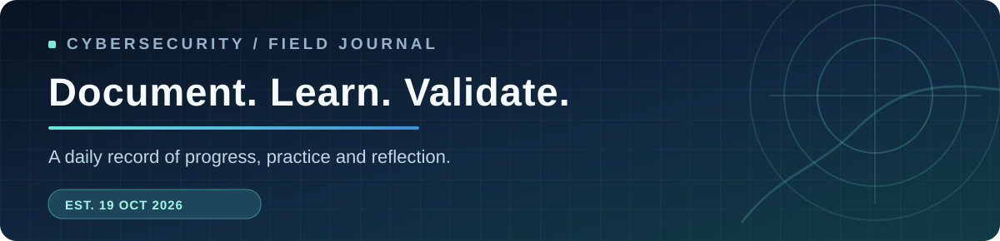

<div align="center">
  <a href="https://github.com/Z1esco"></a>
  <h1>Intern LogBook</h1>
  <p><strong>My cybersecurity internship, documented one day at a time.</strong></p>
  <p>Learning · Security assessment · Vulnerability validation · Technical reporting</p>
  <p>
    
    
    
    
  </p>
</div>



> [!NOTE]
> This journal summarizes internship activities and learning outcomes. Client identities, confidential assessment evidence, and sensitive infrastructure information are omitted.

## 🧭 Overview

Welcome to my **Intern LogBook**, a structured record of my cybersecurity internship undertaken as part of my studies at **Universiti Kuala Lumpur (UniKL)**. This repository captures daily work, technical learning, security validation activities, and reporting experience. The goal is to document real progress clearly, reflect on lessons learned, and maintain a consistent professional logbook.

<table>
  <tr>
    <td width="25%"><strong>🏫 University</strong><br/>UniKL</td>
    <td width="25%"><strong>🛡️ Focus</strong><br/>Cybersecurity</td>
    <td width="25%"><strong>📅 Started</strong><br/>19 Oct 2026</td>
    <td width="25%"><strong>📒 Days logged</strong><br/>08</td>
  </tr>
</table>

## 📆 Daily logbook

Each day follows the **UniKL logbook form**: *Title*, *Descriptions of Jobs/Tasks/Project*, *Activities/Work Produced*, and *Comments/Conclusion*. Every description field is written as **one concise, professional paragraph**, without bullet points.

### October 2026 · Weeks 01–02

| Day | Date | Activity | Entry |
| :--: | :-- | :-- | :--: |
| 01 | Mon, 19 Oct | 🧩 Orientation, ISMS briefings and workstation setup | [Read ↗](logbook/2026/10-october/2026-10-19-day-01.md) |
| 02 | Tue, 20 Oct | 🌐 Server-side web vulnerability labs with Burp Suite | [Read ↗](logbook/2026/10-october/2026-10-20-day-02.md) |
| 03 | Wed, 21 Oct | 🔁 SSRF study and missing CSP header retesting | [Read ↗](logbook/2026/10-october/2026-10-21-day-03.md) |
| 04 | Thu, 22 Oct | 📝 Path traversal study and retesting report consolidation | [Read ↗](logbook/2026/10-october/2026-10-22-day-04.md) |
| 05 | Fri, 23 Oct | 🔎 Network service version retesting and continued web security study | [Read ↗](logbook/2026/10-october/2026-10-23-day-05.md) |
| 06 | Mon, 26 Oct | 📄 Multi-scope VAPT report consolidation and HTB practice | [Read ↗](logbook/2026/10-october/2026-10-26-day-06.md) |
| 07 | Tue, 27 Oct | 🛡️ SQL injection study and Hack The Box practice | [Read ↗](logbook/2026/10-october/2026-10-27-day-07.md) |
| 08 | Wed, 28 Oct | 📝 Penetration testing report drafting and web application retesting | [Read ↗](logbook/2026/10-october/2026-10-28-day-08.md) |

**Browse:** [2026 overview](logbook/2026/README.md) · [October index](logbook/2026/10-october/README.md)

## 🧰 Learning and experience

| Area | Activities documented |
| :-- | :-- |
| **Web application security** | Server-side vulnerability labs, Server-Side Request Forgery (SSRF), Path Traversal, and SQL Injection (SQLi) study |
| **Tools and training** | Burp Suite, PortSwigger Web Security Academy, and Hack The Box (HTB) |
| **Security assessment** | Retesting a missing Content-Security-Policy (CSP) HTTP response header finding; network service version checks for OpenSSH, ClamAV, Portainer, and Apache; web application penetration testing retesting |
| **Technical documentation** | Combined four retesting reports into one document; continued consolidating eight draft VAPT reports covering IPT, INPT, MPOS thick client, cloud, and web assessments; prepared a draft penetration testing report |
| **Professional practice** | ISMS orientation, consulting workflows, reporting standards, and internal escalation procedures |

## 🗂️ Repository map

```text
Intern-LogBook/
├── README.md                         # Journal dashboard and entry index
├── AGENTS.md                         # Entry writing and update conventions
├── assets/
│   ├── logo.svg                      # Original journal emblem
│   └── banner.svg                    # README cover
├── logbook/
│   └── 2026/
│       ├── README.md                 # Year index
│       └── 10-october/
│           ├── README.md             # Monthly index
│           ├── 2026-10-19-day-01.md
│           ├── 2026-10-20-day-02.md
│           ├── 2026-10-21-day-03.md
│           ├── 2026-10-22-day-04.md
│           ├── 2026-10-23-day-05.md
│           ├── 2026-10-26-day-06.md
│           ├── 2026-10-27-day-07.md
│           └── 2026-10-28-day-08.md
├── templates/
│   └── daily-entry.md                # Template for future entries
├── docs/
│   └── editorial-standards.md        # Accuracy and confidentiality rules
└── scripts/
    └── validate_logbook.py           # Local structural and date checks
```

## ✍️ How new entries are added

1. Record what was actually done on a specific date, even if it was training or independent study.
2. Create a dated Markdown file in the correct year/month folder using the [daily template](templates/daily-entry.md).
3. Keep one paragraph for each UniKL form section; do not exaggerate results or invent completed tasks.
4. Update the monthly and yearly indexes, the table above, and the **Days logged** count.
5. Run `python3 scripts/validate_logbook.py` before committing.

## 🔐 Confidentiality and accuracy

This repository is **public**, so all entries must remain high-level and anonymized. Entries describe only work actually performed. They do not contain client names, IP addresses, hostnames, credentials, private reports, screenshots of internal systems, or other sensitive findings. See the [editorial standards](docs/editorial-standards.md).

---

<div align="center">
  <sub>Built and maintained by <a href="https://github.com/Z1esco">@Z1esco</a> · UniKL Cybersecurity Internship · Started October 2026</sub>
</div>
